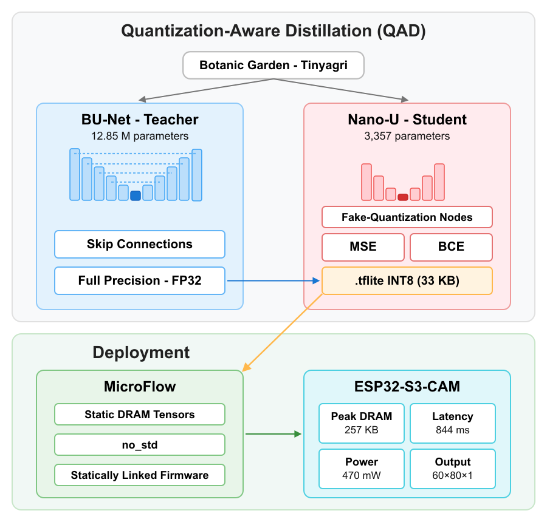

# Nano-U

> **Binary terrain segmentation in 3,357 parameters - small enough to run bare-metal on a $10 microcontroller.**
> Distilled with quantization awareness | Deployed in pure Rust | 1.7 FPS on an ESP32-S3, no ML accelerator.

[](https://www.python.org/)
[](https://www.tensorflow.org/)
[](https://esp-rs.github.io/book/)
[](LICENSE)
[](LICENSE)
[](https://huggingface.co/datasets/federico-pizz/TinyAgri)

---

Nano-U is a tiny encoder-decoder segmentation network built for autonomous navigation on commodity embedded hardware. Architecture, training, and deployment are co-designed around one hard constraint: **320 KB of Data RAM, no ML accelerator.**

Two ideas make it fit:

- **Quantization-Aware Distillation (QAD)** - a single-pass regime that fuses knowledge distillation from a full-precision BU-Net teacher with INT8 fake-quantization from epoch one.
- **A compile-time Rust engine** - a [fork of MicroFlow](https://github.com/federico-pizz/microflow-rs) that resolves the whole operator graph at build time: no heap allocator, no dynamic dispatch, no interpreter.

> **Want more speed?** The [`multicore`](../../tree/multicore) branch splits inference across both Xtensa cores for **~27% lower latency** (~2.35 FPS vs ~1.7 FPS) with bit-identical output. See [Branches](#branches).

---

## Results

### Segmentation Accuracy

| Model | Dataset | mIoU | F1 | Precision | Recall |
|:---|:---|:---:|:---:|:---:|:---:|
| BU-Net (Teacher, Float32) | Botanic Garden | 95.2% | 95.8% | 96.9% | 94.7% |
| Nano-U (Float32) | Botanic Garden | 87.6% | 88.3% | 94.0% | 83.3% |
| **Nano-U (INT8, on ESP32)** | **Botanic Garden** | **87.6%** | **88.4%** | **94.1%** | **83.3%** |
| BU-Net (Teacher, Float32) | TinyAgri | 90.9% | 95.2% | 93.9% | 96.5% |
| Nano-U (Float32) | TinyAgri | 88.4% | 93.7% | 93.5% | 94.0% |
| **Nano-U (INT8, on ESP32)** | **TinyAgri** | **88.4%** | **93.7%** | **93.5%** | **93.9%** |

The near-zero Float32->INT8 gap (~0 pp mIoU on both domains) shows QAD carries accuracy through quantization - the on-device INT8 model matches its Float32 source within measurement noise.

### Qualitative Results

Raw input, ground-truth mask, and Nano-U INT8 prediction across both domains:


### Training Pipeline

The QAD loop: fake-quantization nodes are injected from epoch one, so the optimizer minimizes distillation loss (teacher soft targets) and quantization error (INT8 rounding) at the same time.



### Hardware Efficiency (ESP32-S3-CAM)

| Metric | Value |
|:---|:---:|
| Parameters | 3,357 (INT8) |
| Model size | 33 KB |
| Peak internal RAM | 281 KB |
| Inference latency | 581 ms (~1.7 FPS) |
| Power consumption | 470 mW |

Peak RAM measured via stack painting (hardware high-water mark). Power measured at the 5V USB rail, inclusive of LDO, OV2640 camera, and USB-UART bridge.

---

## Architecture

Nano-U is a strictly sequential 7-stage encoder-decoder. Skip connections are omitted on purpose - holding encoder feature maps in SRAM until the decoder consumes them would blow the 320 KB budget. Depthwise separable convolutions (K=3) are used throughout.

| Stage | Spatial | Channels | Operation |
|:---|:---:|:---:|:---|
| Encoder 1 | 60x80 -> 30x40 | 3 -> 4 | DW-Sep Conv x 2, MaxPool 2x2 |
| Encoder 2 | 30x40 -> 15x20 | 4 -> 8 | DW-Sep Conv x 2, MaxPool 2x2 |
| Encoder 3 | 15x20 -> 5x10 | 8 -> 16 | DW-Sep Conv x 2, MaxPool **3x2** |
| Bottleneck | 5x10 | 16 | DW-Sep Conv x 2 |
| Decoder 1 | 5x10 -> 15x20 | 16 -> 16 | NN Upsample 3x2, DW-Sep Conv x 2 |
| Decoder 2 | 15x20 -> 30x40 | 16 -> 8 | NN Upsample 2x2, DW-Sep Conv x 2 |
| Decoder 3 | 30x40 -> 60x80 | 8 -> 1 | NN Upsample 2x2, DW-Sep Conv x 2 |

The asymmetric 3x2 MaxPool at Stage 3 reduces 15x20 cleanly to 5x10 with no spatial misalignment. The largest intermediate tensor is 60x80x4 = 19.2 KB (INT8), keeping the arena within budget.

Parameter count is reported at three stages: the plain Float32 architecture has **4,212** weights; QAT wraps these in fake-quant nodes for a saved-checkpoint count of **4,688**; and at TFLite export the batch-norm statistics fold into the preceding convolutions, leaving **3,357** stored INT8 parameters with no accuracy loss.

SVD-based redundancy scores (`src/nanou/redundancy.py`) track layer utilization during training. They empirically confirm that encoder layers generalize across domains while decoder layers are domain-specific - motivating the decoder-only re-distillation strategy in [Limitations](#limitations).

### Quantization-Aware Distillation

$$\mathcal{L} = \alpha \cdot T^2 \cdot \mathcal{L}_\text{KD} + (1 - \alpha) \cdot \mathcal{L}_\text{CE}$$

where $\mathcal{L}_\text{KD}$ is MSE between temperature-scaled sigmoid outputs of teacher and student, $\mathcal{L}_\text{CE}$ is binary cross-entropy against hard labels, and $T^2$ compensates for the gradient magnitude reduction from temperature scaling.

$\alpha$ weights the **distillation** term; $(1-\alpha)$ weights the supervised term. Fake-quantization nodes are inserted before epoch 1 and gradients pass through them via the straight-through estimator, so the student learns the teacher's decision surface and a quantization-robust weight configuration in one pass. The INT8 scales and zero-points are then calibrated on real images (`quantization.calibration_split`, default `val`) and written to `<model>_quant_params.json` for `firmware/build.rs`.

### Relation to the published paper

The numbers above are **not** the ones in the [TAROS 2026 paper](#citation); the paper reports the state of the system at submission, and the repo has moved since. Both are reproducible - the difference is which config you run:

| | Paper (arXiv:2605.10210) | This repo (current) |
|:---|:---|:---|
| Preset | `botanicgarden-paper`, `tinyagri-paper` | `botanicgarden`, `tinyagri` |
| Distillation ($T$, $\alpha$) | BG 8.0 / 0.3; TinyAgri 4.0 / 0.5 | BG 4.0 / 0.3; TinyAgri 0.7 / 0.3 |
| Supervised loss | BCE only | BG: BCE; TinyAgri: 0.3*BCE + 0.7*Tversky (0.8/0.2) |
| Botanic Garden mIoU (FP32 / INT8) | 0.870 / 0.870 | 0.876 / 0.876 |
| TinyAgri mIoU (FP32 / INT8) | 0.883 / **0.700** | 0.884 / 0.884 |
| Inference latency | 845 ms (1.2 FPS) | 581 ms (~1.7 FPS), 426 ms on `multicore` |
| Peak Data RAM | 257 KB | 281 KB |
| Power | 470 mW board (137 mW idle, 333 mW active) | unchanged |

Three changes account for the gaps:

- **The TinyAgri INT8 collapse (0.883 -> 0.700) is attributable to a calibration plumbing bug rather than to QAD itself.** `export_int8` did not forward `--config` to the quantizer, so INT8 calibration always read whatever the single template config happened to contain, regardless of which config trained the model - calibrating on another domain's images, or on random noise when the paths were placeholders. Botanic Garden was unaffected because it was the domain that template was filled in for. The config is now threaded through, and missing calibration images raise instead of silently degrading to noise.
- **The tuned configs** come from the leakage-safe grouped CV sweep (`scripts/sweep.py`) run after submission; TinyAgri in particular moved to a precision-favoring Tversky blend and a sharpening $T<1$. The sweep file for each stage is in `sweeps/`.
- **Latency and RAM** reflect the buffer-reuse work in the inference engine: faster (845 -> 581 ms) at the cost of a slightly larger static arena (257 -> 281 KB).

How much of the 0.700 -> 0.884 move is the bug fix alone and how much is the tuning, and whether 0.870 vs 0.876 is outside run-to-run noise, are open; `experiments/seed_variance.py` gives the error bars.

---

## Branches

Two deployment pipelines live in parallel branches, each paired with a matching MicroFlow branch:

| Branch | Cores | Latency | Notes |
|:---|:---:|:---:|:---|
| [`main`](../../tree/main) (this one) | 1 | 581 ms (~1.7 FPS) | Simpler, lower-stack single-core baseline |
| [`multicore`](../../tree/multicore) | 2 | 426 ms (~2.35 FPS) | Splits each heavy layer across both Xtensa LX7 cores; bit-identical output |

The training/evaluation stack is identical on both - only the firmware inference path differs. See [`firmware/README.md`](firmware/README.md) for the build details.

---

## Datasets

Nano-U is dataset-agnostic: any binary terrain-segmentation dataset laid out as
`data/<name>/{train,val,test}/{img,mask}` works by pointing a preset's `data_root` at it.
The two below are the ones behind the results in this repo and its accompanying publication.

### Botanic Garden
An outdoor robot navigation benchmark collected in a 48,000 m^2 unstructured environment. We use 1,181 images from all 5 annotated sequences, split by contiguous sequence (70/20/10) to prevent temporal leakage. Binary traversability masks are derived from the original *path* class annotations.

**Original Source:** [robot-pesg/BotanicGarden](https://github.com/robot-pesg/BotanicGarden)

### TinyAgri
A custom terrain segmentation dataset captured with the onboard OV2640 camera of an ESP32-CAM mounted on a SunFounder Galaxy RVR rover. 2,659 images across two agricultural environments (tomato and corn fields), annotated with SAM 2. Released alongside this project to support future edge-robotics research.


---

## Installation

Requires Python 3.12 (TensorFlow has no wheels for 3.13/3.14).

```bash
git clone https://github.com/federico-pizz/Nano-U.git
cd Nano-U
python -m venv .venv && source .venv/bin/activate
pip install -r requirements.txt
```

### GPU (optional)

The pinned install is CPU-only so it works everywhere; the test suite runs on CPU and GPU-marked tests skip automatically. For an NVIDIA GPU, install a CUDA-capable build:

```bash
pip install "tensorflow[and-cuda]==2.20.0"
```

> Very new GPUs (RTX 50-series / Blackwell, sm_120) aren't covered by stock TensorFlow builds yet - they need a CUDA 12.8+ toolkit and a TensorFlow nightly, typically in a separate conda environment. Install the package there with `pip install -e ".[gpu,qat]"`, which takes the nightly distribution names instead of the pinned stable ones. See NVIDIA's Blackwell compatibility guide.

For Rust firmware build and deployment, see [`firmware/README.md`](firmware/README.md).

---

## Usage

### Pre-trained Models

INT8 TFLite models for both domains ship in the repo under `models/`:

```
models/
|-- BotanicGarden/nanou.tflite
+-- TinyAgri/nanou.tflite
```

You can evaluate these directly without training from scratch (see [Evaluate](#evaluate)).

### Training

Pick a preset, then pick one of the two (mutually exclusive) options. `--preset`
is the only flag a full run needs; every script takes it and defaults to
`tinyagri`.

| Preset | What it is |
|:---|:---|
| `tinyagri` | TinyAgri, tuned - the current headline numbers |
| `botanicgarden` | Botanic Garden, tuned |
| `tinyagri-paper` | TinyAgri, as submitted |
| `botanicgarden-paper` | Botanic Garden, as submitted |

For your own dataset, copy a preset and change `data_root`, `models_dir` and
`output_dir`. Anything you do not set comes from `config/base.yaml`, and a key
that is not part of the schema is an error rather than a silent default.

**Option A - QAD Pipeline (recommended).** All four phases in one shot: teacher training -> student training with distillation -> INT8 TFLite export -> evaluation.

```bash
python scripts/train.py --preset tinyagri
```

**Option B - Standard training (no distillation).** Trains teacher and student independently.

```bash
python scripts/train.py --no-distill --model bu_net --preset tinyagri   # Teacher
python scripts/train.py --no-distill --model nanou --preset tinyagri   # Student
```

### Evaluate

```bash
python scripts/evaluate.py nanou --preset tinyagri            # held-out test split
python scripts/evaluate.py nanou --preset tinyagri --format fp32   # the Keras model, not the .tflite
python scripts/evaluate.py nanou --preset tinyagri --split val --threshold 0.6
python scripts/evaluate.py nanou --preset tinyagri --info     # parameter counts, layers, summary
```

Reports mIoU, Dice, precision/recall and the F0.5/F1/F2 family, plus a precision-recall curve and a metric-vs-threshold sweep. When frames carry sequence ids it adds a per-sequence variance breakdown. Everything lands in `results/<dataset>/<model>/`: two figures and one report, `eval_<format>_<split>.json`. `--format int8|fp32` picks the file that is scored (default: the INT8 `.tflite` when it has been exported); both formats go through the same forward path, and `scripts/device_eval.py` scores the board's output through it too.

### Hyperparameter search (leakage-safe CV)

Grouped k-fold sweep over distillation temperature/alpha, augmentation regime, the CE-loss ablation, and the conservative Tversky term, with each whole capture sequence kept inside one fold. Selects by mIoU with F0.5 as the safety tiebreak.

```bash
python scripts/sweep.py sweeps/tinyagri-stage3.yaml --preset tinyagri --jobs 3
```

The sweep file holds the folds, the epochs and the grid: temperature, alpha, augmentation regime, the CE-loss ablation (`ce: [on, off]`, off == `alpha=1.0`) and the precision-favoring loss `(1-w)*BCE + w*Tversky` as `[w, alpha_fp, beta_fn]` triples. The files in `sweeps/` are the stages that produced the tuned presets; each one says what it picked, and the preset comments carry the numbers. The command line only describes the machine: `--jobs N` runs N **student** pipelines concurrently, the heavy BU-Net teacher has its own `--teacher-jobs` (default 1), and `--output` moves the table from `results/<dataset>/cv/<sweep name>/`. `k` must be <= the number of distinct sequences, and a `min_miou` floor that no config clears is an error, not a warning.

### Experiments

Claims that need a training run to settle - QAD against QAT-only, KD-only and PTQ, the distillation temperature with and without the $T^2$ factor, and seed-to-seed variance - live in [`experiments/`](experiments/README.md), one table each.

### On-Device Evaluation

```bash
python scripts/device_eval.py nanou --preset tinyagri
```

### MCU Deployment

See [`firmware/README.md`](firmware/README.md) for build setup, binary descriptions, and environment variables.

---

## Project Structure

```
Nano-U/
|-- config/
|   |-- base.yaml               # Every default, in one place
|   +-- presets/                # One file per dataset x (tuned | as submitted)
|-- sweeps/                     # CV sweep files, one per search stage
|-- experiments/                # Ablations and seed variance, one table each
|-- src/nanou/                 # The library; nothing in it is executable
|   |-- architectures.py        # Nano-U and BU-Net
|   |-- blocks.py               # Layer builders shared by both architectures
|   |-- config.py               # Preset resolver and TrainConfig
|   |-- data.py                 # tf.data pipelines and augmentation
|   |-- distill.py              # DistillModel - the QAD objective
|   |-- losses.py               # Tversky loss
|   |-- qat.py                  # Fake-quantization wrappers
|   |-- train.py                # Training loops (standard + distillation)
|   |-- quantize.py             # INT8 TFLite export and calibration
|   |-- metrics.py              # mIoU and the segmentation metrics
|   |-- evaluate.py             # Evaluation and visualization
|   |-- redundancy.py           # SVD channel-redundancy monitoring
|   +-- device/                 # Serial protocol, flashing, on-device eval
|-- scripts/
|   |-- train.py                # QAD pipeline (--no-distill for the plain path)
|   |-- evaluate.py             # Host evaluation (--info for model stats)
|   |-- export.py               # INT8 TFLite + quant_params.json
|   |-- bench.py                # Host-side latency benchmark
|   |-- sweep.py                # Leakage-safe grouped-CV search, grid from a sweep file
|   |-- device_eval.py          # On-device inference and evaluation
|   |-- capture.py              # Decode live-camera frame dumps (capture bin) to PNG
|   +-- profile.py              # Stack painting and energy profiling
|-- firmware/                   # ESP32-S3 bare-metal Rust
|   |-- src/bin/
|   |   |-- online.rs                 # Live-camera control loop (OV2640 -> nav decision)
|   |   |-- capture.rs                # Live-camera frame dump for pipeline validation
|   |   |-- run.rs                    # Continuous inference loop (default target)
|   |   |-- inference.rs              # One-shot INT8 benchmark over all test images
|   |   |-- single_inference.rs       # Single-image inference + serial output
|   |   |-- analysis.rs               # Stack painting + power profiling (Nano-U)
|   |   +-- analysis_person_detect.rs # Stack painting + power profiling (person_detect)
|   |-- src/camera.rs                 # OV2640 live-capture driver
|   |-- src/control.rs                # Pure navigation policy
|   +-- build.rs                      # Compile-time quantization param extraction + image packing
|-- models/
|   |-- BotanicGarden/nanou.tflite
|   +-- TinyAgri/nanou.tflite
+-- data/
    |-- BotanicGarden/
    +-- TinyAgri/
```

---

## Hardware

All experiments use an **ESP32-S3-CAM** (dual-core Xtensa LX7 @ 240 MHz, 512 KB internal SRAM, 16 MB PSRAM, OV2640 camera). No ML accelerator is present; all integer arithmetic runs on the general-purpose ALU. See [`firmware/README.md`](firmware/README.md) for build, binary descriptions, and environment variables.

---

## Limitations

- **Single-core inference (this branch).** `main` runs the operator graph on one Xtensa LX7 core, leaving the second idle. The [`multicore`](../../tree/multicore) branch spreads each heavy conv/depthwise layer across both cores for ~27% lower latency with bit-identical output; `main` stays single-core as the simpler, lower-stack baseline.
- **Fixed-domain deployment.** Nano-U is re-trained from scratch per domain. SVD redundancy scores suggest the encoder generalizes while the decoder is domain-specific, motivating decoder-only re-distillation for new domains.

---

## Citation

If you use Nano-U or the TinyAgri dataset, please cite:

```bibtex
@article{pizzolato2026nanou,
      title={Nano-U: Efficient Terrain Segmentation for Tiny Robot Navigation}, 
      author={Federico Pizzolato and Francesco Pasti and Nicola Bellotto},
      year={2026},
      booktitle={Towards Autonomous Robotic Systems}
}
```

---

## License

Dual-licensed under the **MIT License** and the **Apache License 2.0** - use it under either, at your option. See [LICENSE](LICENSE) for the full text.
